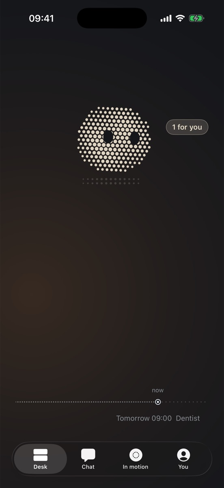
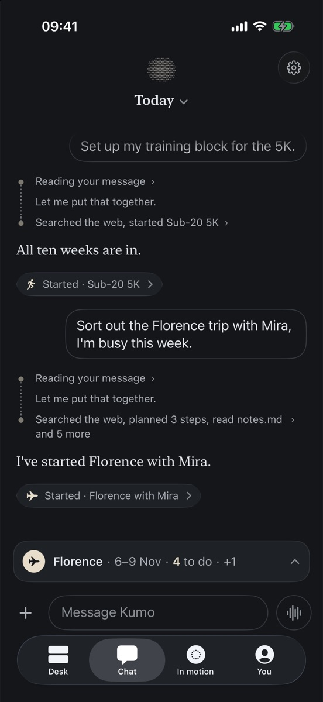
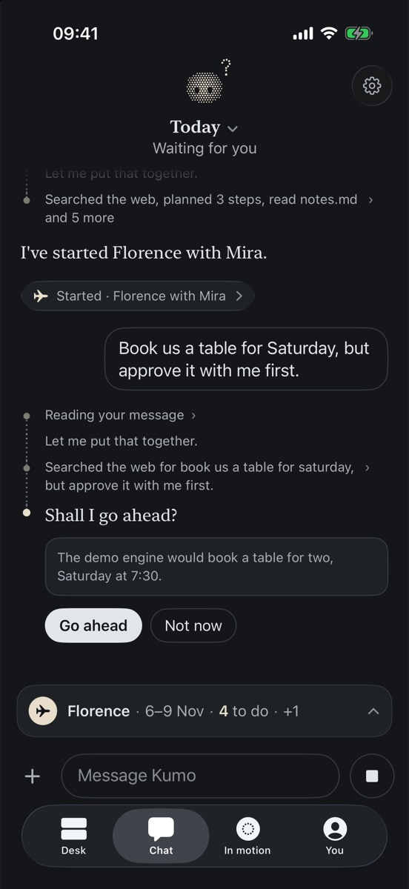
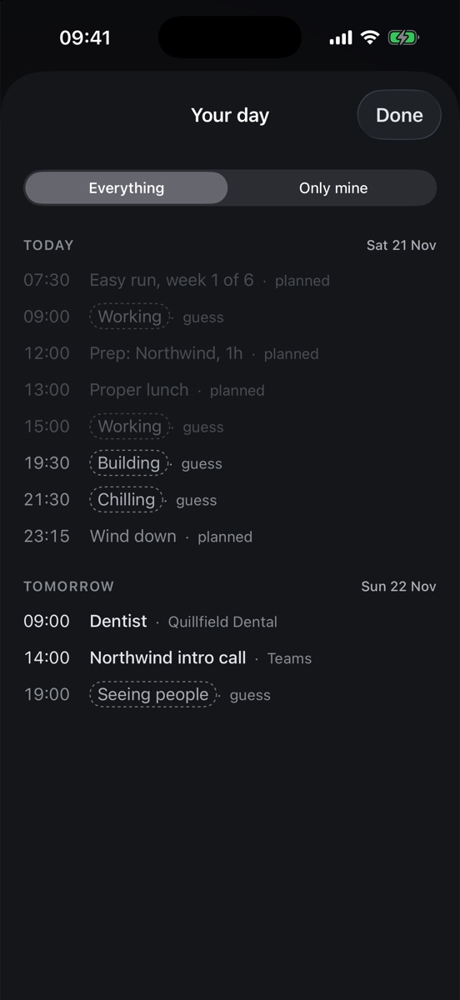
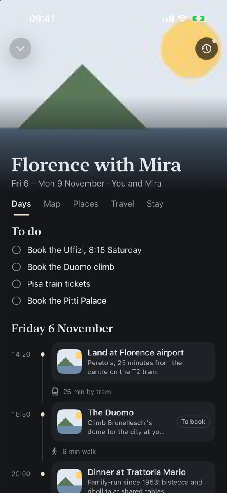
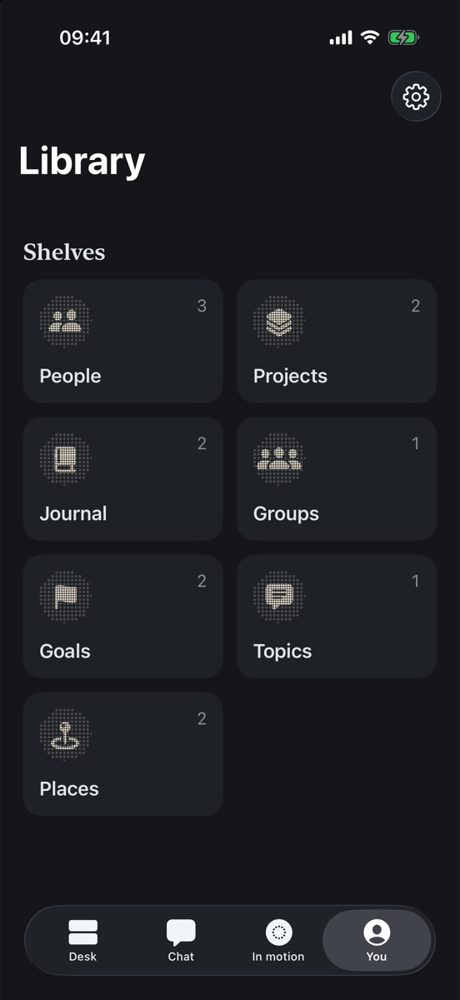

#  Ito for iPhone

**The iPhone app for Ito, a personal agent you run yourself: a Desk for what's waiting on you, and
one continuous conversation with Kumo, the agent, live.**

[](https://github.com/akai-ito/ari-ios/actions/workflows/ci.yml)

The app is a thin client for an Ito server, [ito-core](https://github.com/akai-ito/ito-core), which
runs the agent, reads your mail and keeps your memory. The app renders what the server says, so the
conversation is the same wherever you pick it up. The repository and its code still say Ari, the
app's earlier name.

<p align="center">
  
  
  
</p>
<p align="center">
  
  
  
</p>
<p align="center"><sub>Every name and detail is fictional: ito-core's demo engine and a few made-up
memory pages, in the iOS Simulator.</sub></p>

> [!NOTE]
> You build the app yourself in Xcode for now; TestFlight comes later. Still to come: a light mode
> and an iPad layout.

## What's in it

- **The Desk.** Where the app opens. Kumo sits in its current mood, today as a dotted line at the
  foot, and three cues in the scene. "2 for you" shows only while something waits on you (drafts to
  send from Mail, invites, questions) and opens just that list. Over Kumo's shoulder hangs the moon
  from the night's dream until you've seen it, then the sun, low and amber in the evening; either
  opens one page: what the dream planned, tidied, noticed and saved for you, with its weave
  replayed, then today's plans and what's done, each with its why, Undo and "That was wrong", and
  Dream now. Kumo itself opens Getting to know you: the areas it's learning, and the few things it
  would like you to explain, answered with a tap, your words or your voice. At night Kumo sleeps;
  while it dreams its thoughts drift up as words, and a tap watches the day being woven. Tapping
  the day opens it as a list, with Kumo's planned blocks and its guesses marked as guesses.
- **Chat.** One conversation, streamed at a reading pace. Between your message and Kumo's answer,
  its trail shows what it did in plain words; tap a step for the specifics. Stop works at once.
  When Kumo needs your go-ahead or an answer, it asks on the trail and waits.
- **Side threads.** A subject of its own goes in a thread beside the main chat, with its own
  conversation on the server, so talking in one never steers another aside. Kumo starts one for a
  one-off, a new subject or long work; replying to any message starts one under it. A resting thread
  is one quiet line in the chat, and Threads by day lists them, open ones first.
- **Replies that show.** Where Markdown can't, Kumo writes an `ari:` block the app draws: a table
  that fits a phone with a verdict chip on each row, its picks with pictures, the number that
  matters, short answers to tap, pictures it found, or a line that opens a thing in motion. What you
  can act on comes as a card: a place with Directions, an event with Add, a Desk card exactly as the
  Desk has it, and a person. A name Kumo keeps is dotted; tap it for a small card about them.
- **Recordings, files and changes to approve.** A recorded conversation, from Voice Memos' share
  sheet or the +, goes up in chunks that iOS carries in the background, resumed after any drop.
  Its card follows the upload and the server's transcription; the transcript opens with a player,
  the line being said lit, and a misheard name fixed everywhere it was heard. Kumo's proposed
  changes are rows to approve one at a time, and a file it made opens at its version, with Use in
  draft.
- **Pages Kumo made.** A rich answer worth keeping, such as a gallery guide, comes as a card that
  opens a page with sections that fold and things to tick off, kept current by Kumo. Share sends it
  as clean text, and every page is on the Library's Made shelf.
- **In motion.** What you're actually doing, kept current as you talk, pinned above the composer and
  in its own tab, in six sections that never move: Career, Body, Trips, Projects, Learning and
  Other. The loudest thing in a section is big and the quiet ones fold away. A role shows its
  pipeline, a training block this week as a coach would (planned against done, trends only from
  real numbers), and a trip its days, a map, its places and its travel. Ended things go to History
  by how they ended, each with its short story.
- **Memory.** The You tab is Kumo's memory, the Library, read as a reflection: Now in a few lines,
  the chapters of your life Kumo noticed (each a short story with its photos), what Kumo learnt
  about you lately in its own words, then pages on shelves and a journal, in the phone's search,
  with what changed and when.
- **Talk.** A call with Kumo through CallKit: your voice goes to your server, and Kumo's comes back
  with captions as each line is heard.
- **Capabilities and setup.** Mail, calendar and the rest connect through the provider's own page
  where it can ("Connect Outlook") or guided steps where it can't, so keys go to your server and
  never come back. Getting started walks through it in five short steps.
- **Notifications.** Every message from Kumo notifies, decrypted on the phone: Apple's push service
  only carries ciphertext.

## How it's built

| Path | What it is |
| --- | --- |
| [Ari](Ari) | The app, in SwiftUI for iOS 26: the Desk, Chat, In motion, the Library, Talk and Settings |
| [AriKit](AriKit) | Everything but the screens: the protocol's models, the conversation store, the session and its networking, the outbox, the reading pace |
| [AriNotificationService](AriNotificationService), [AriShare](AriShare), [AriControls](AriControls) | Extensions: decrypting notifications, sharing into Ito, a Control Center control |
| [AriUITests](AriUITests) | UI tests that drive the app against the demo engine |
| [protocol](protocol) | ito-core's client API, copied at the commit in [protocol.pin](protocol.pin) |
| [project.yml](project.yml) | The Xcode project, which XcodeGen generates |

- **One store, fed by the server.** `Conversation` is a value built from the server's events,
  applied in order. The app changes it ahead of the server only for what you do (your message the
  moment you send it, Stop, Try again), and the server then confirms each.
- **Tolerant decoding.** Every event decodes envelope first, so an event type the app doesn't know
  is skipped while its id still moves the cursor, unknown fields are ignored, and unknown values
  fall back as the protocol says, so what a newer server adds doesn't break an older app.
- **A session that stays live.** `Session` resumes the event stream from the last event it
  applied, reconnects with backoff the moment the network returns, and treats 45 seconds without
  even a ping as a lost connection. A reply whose pieces don't line up asks for a fresh snapshot
  rather than showing wrong text.
- **Readable offline.** What you've loaded (the chat and its threads, the Desk, In motion, the
  Library and the pages Kumo made, with their photos) is kept on the device and shows at once when
  Ari opens, with or without a connection, marked "Offline · updated 14:02" while it's the copy.
  When the server is back, its snapshot replaces the copy in place. What the server must answer at
  once, such as a card's answer or Undo, waits while offline; messages queue as ever. The copy is
  readable only once the phone has been unlocked, stays out of backups, and goes when you leave the
  server.
- **Never lose a message.** Each message is saved on the device before it's sent, then sent in
  order, with the same id until the server has it, even across a restart. Stop, Try again, calls
  and the rest each have a lane of their own, so none waits behind a send or a reconnect.
- **Reading at a person's pace.** `Reveal` shows a reply at a steady reading pace, catching up when
  the screen falls behind. `ReplyDocument` parses Markdown with Apple's
  [swift-markdown](https://github.com/swiftlang/swift-markdown) and keeps where each run sits in the
  source, so text never reflows as it arrives.
- **A first connection that names the problem.** `Connector` checks the address (HTTPS, or plain
  HTTP to this device only), that an Ito server answers, that it speaks the app's protocol (and if
  not, which side to update), and then the token. Or it pairs with the one-time code `ito pair`
  shows as a QR code. The token lives in the Keychain and is never printed in full.

## Build and run

You need Xcode 27 and [XcodeGen](https://github.com/yonaskolb/XcodeGen) (`brew install xcodegen`).

```sh
xcodegen generate   # writes Ari.xcodeproj; run it again whenever project.yml changes
open Ari.xcodeproj
```

The app runs in the Simulator as it is. To try it without an agent or any accounts, run ito-core's
demo engine on your Mac ([five-minute demo](https://github.com/akai-ito/ito-core#try-it-in-five-minutes))
and connect to `http://127.0.0.1:8787` with the token it prints. A message with *trip* in it starts
a sample trip, *busy* walks a trail of steps, *mail* puts a draft on the Desk, *plan* lays out a
day, *approve* asks before acting, and *long*, *fail* and *silent* try Stop, a failure and a
timeout.

In debug builds, environment variables drive the app without typing, which is how the screenshots
above were taken: `ARI_SERVER` and `ARI_TOKEN` fill in the connect screen, `ARI_SAY` sends a message
once Chat is open, `ARI_PLACE` opens a tab (`chat`, `motion` or `library`), `ARI_DESK` opens part of
the Desk (`needs`, `sky`, `plans`, `know`, `question`, `weave`, `day`, `problems` or `wrong`), and
`ARI_MOTION` opens a thing in motion. `ARI_STILL` (`morning`, `afternoon`, `evening`, `asleep`,
`dreaming`, `dreamt` or `asked`) runs the Desk on made-up samples with no server, and `ARI_CLOCK`
(such as `07:40`) sets the time it shows.
[DebugScript.swift](Ari/DebugScript.swift) lists the rest. From `xcrun simctl launch`, prefix each
with `SIMCTL_CHILD_`.

To use your own server from your iPhone, reach it over your tailnet:
`tailscale serve --bg --https=8443 8787` on the server gives an HTTPS address the app accepts. To
run the app on your iPhone, copy `Config/Local.xcconfig.example` to `Config/Local.xcconfig`, which
git ignores, and set your Apple team there. If you sign with your own team, choose your own bundle
identifier there too.

## Tests

```sh
swift test --package-path AriKit
```

Most tests play ito-core's [golden transcripts](protocol/transcripts), one per scenario, at two
levels:

- **The store.** Each event, send, Stop, Try again and answer in a transcript goes to the store.
  It must end as the transcript's own messages do, read from its JSON, with no message shown
  twice, no text revised and no status outliving its turn.
- **The client.** The transcript's server sits behind the transport, its network drops and
  restarts happen on cue, and a test clock stands in for time. Ari must make exactly the
  transcript's requests, in order, and end with the store's conversation. More tests cover what the
  transcripts don't: a silent connection, Stop while reconnecting or before the turn is announced,
  Retry-After, a rejected token and a restart with messages waiting.

Other tests check that every event and answer decodes, that what Ari doesn't know is tolerated,
and that the models know every event type, required field and value in the pinned spec.

A few tests run against a real server and are skipped unless you point them at one. In an
[ito-core](https://github.com/akai-ito/ito-core) clone, run `node bin/ito.ts serve --engine demo`,
which answers without an agent and prints a token on its first run; then:

```sh
ITO_SERVER=http://127.0.0.1:8787 ITO_TOKEN=<token> swift test --package-path AriKit
```

With `ITO_PAIRING_CODE` set to a fresh code from `node bin/ito.ts pair`, they pair too.

The app's own interactions have UI tests in [AriUITests](AriUITests): sending, Stop, Try again,
answering an ask, links, the trail, the long-press menu, Settings, and the
conversation's scrolling (margins, following, the keyboard). They drive the app as you would,
against the demo engine, so they're opt in: connect Ari to a demo server in the Simulator once,
then run

```sh
xcodebuild test -project Ari.xcodeproj -scheme AriUITests -destination 'platform=iOS Simulator,name=<simulator>'
```

## Things that bit us

Each cost a round of bugs on a real phone. The code says why where it matters; this is the list to
read before changing these parts.

- **Run `xcodegen generate` after pulling.** `Ari.xcodeproj` isn't in git, and a stale one still
  builds, because the app's sources are a synced folder, but without what `project.yml` added since:
  entitlements, Info.plist keys, extensions. The build now stops when `project.yml` is newer.
- **The Simulator hides two classes of bug.** It doesn't enforce Keychain access groups, so the app
  group's Keychain works there even without the entitlement, and it doesn't run notification
  service extensions for `simctl push`. Check those on a phone.
- **Finish iOS's completion handlers on the main thread.** The async forms of
  `UNUserNotificationCenterDelegate` call them from a background task, and UIKit aborts.
- **Don't let the conversation redraw on every frame or keystroke.** The reading pace moves 30
  times a second: only the message being revealed may redraw (`RevealModel`, `Paced`). The
  composer's text field measures itself with TextKit whenever it redraws, so it lives in its own
  equatable view (`ComposerArea`).
- **Scroll to rows as wide as the screen.** Scrolling to a row lines up its edge with the screen's:
  a row starting at a margin slides everything sideways. And a lazy stack guesses the heights of
  rows it hasn't drawn, which made the conversation jump or scroll into blank space, so it's a
  plain stack of the latest rows.
- **Follow the end on new rows only, without animation.** Following every change in height, with an
  animation, fed itself in a long conversation and froze the screen.
- **Don't hand a closure down the environment from a view that redraws every frame.** Each redraw
  makes a new one, so everything reading it redraws too. The pinned line, redrawn under the
  conversation every frame, kept it from following a reply. Make such a value equatable on what
  matters (`MotionOpener`).

## The protocol

[protocol](protocol) is ito-core's
[protocol directory](https://github.com/akai-ito/ito-core/tree/main/protocol), copied byte for byte
at the commit in [protocol.pin](protocol.pin): the spec, the guarantees and the transcripts, with
the generator and TypeScript types its pages link to. Ari never changes it; the protocol changes in
ito-core first. To move to a newer one:

```sh
.github/scripts/sync-protocol main   # or any commit on ito-core's main branch
```

Then commit `protocol` and `protocol.pin` together. CI fails whenever the copy and the pin disagree.

## Formatting

CI checks the Swift with the swift-format that comes with Xcode, configured in
[.swift-format](.swift-format). To format everything:

```sh
swift format format --in-place --recursive Ari AriKit
```

## Licence

Source-available under your choice of the
[PolyForm Noncommercial](LICENSES/PolyForm-Noncommercial-1.0.0.md) or
[PolyForm Small Business](LICENSES/PolyForm-Small-Business-1.0.0.md) licence; see
[LICENSE.md](LICENSE.md).
